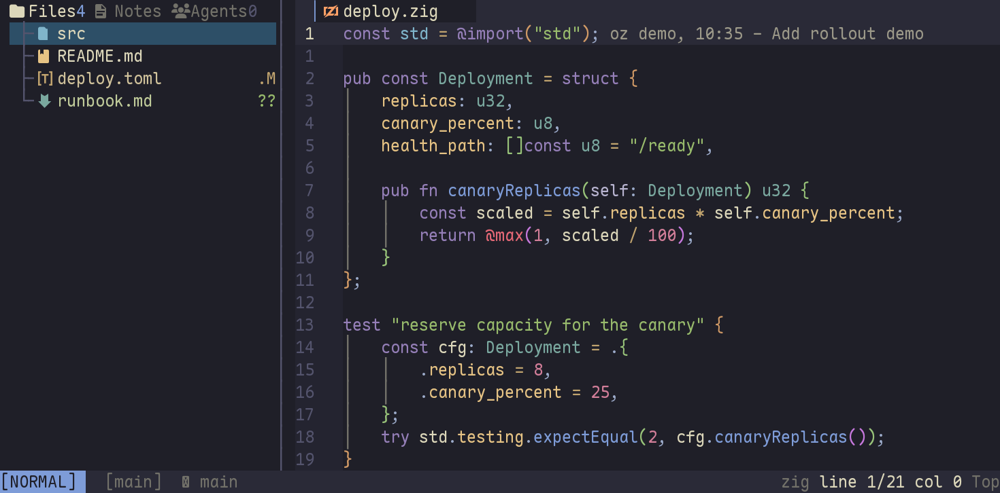

# oz

A Vim-style terminal editor written in Zig. Edit in splits, look up symbols with LSP, and work alongside Codex, Kimi Code or DeepSeek Harness through ACP.

[Download](https://github.com/niT-Tin/oz/releases/latest) · [Website](https://nit-tin.github.io/oz/?lang=en) · [中文](README.zh-CN.md)



## Open your first file

Download the archive for Linux or macOS (x86_64 or arm64), extract it, then run:

```sh
./oz path/to/file
```

Press `i` to edit, `Esc` to return to Normal mode, and `:wq` to save and quit. `Space e` opens the file tree. `F1` shows the full keymap.

[Connect a coding agent](https://nit-tin.github.io/oz/?lang=en#agents) · [Build from source](https://nit-tin.github.io/oz/?lang=en#download) · [Changelog](CHANGELOG.md) · [MIT license](LICENSE)
