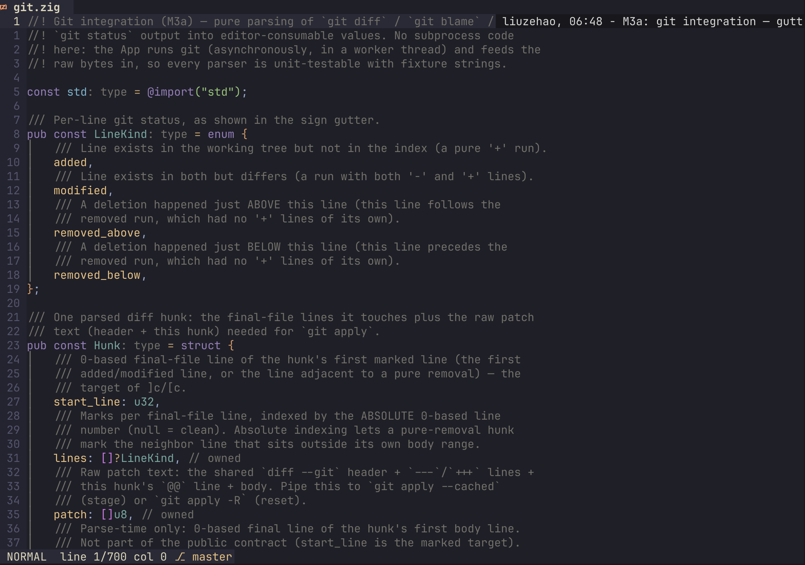
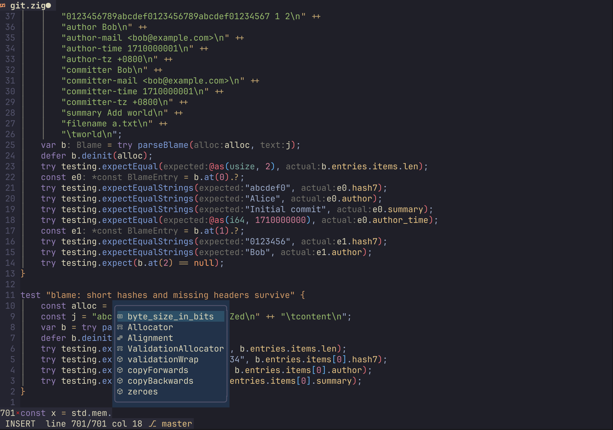
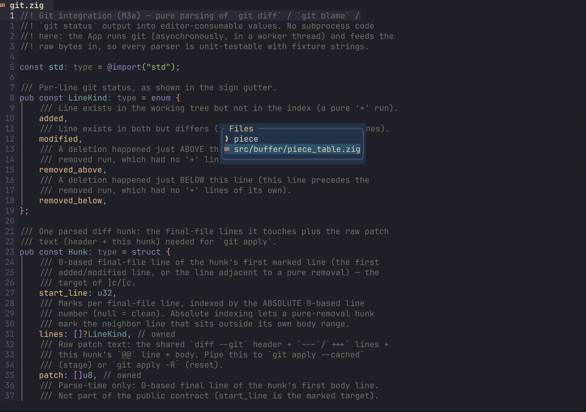
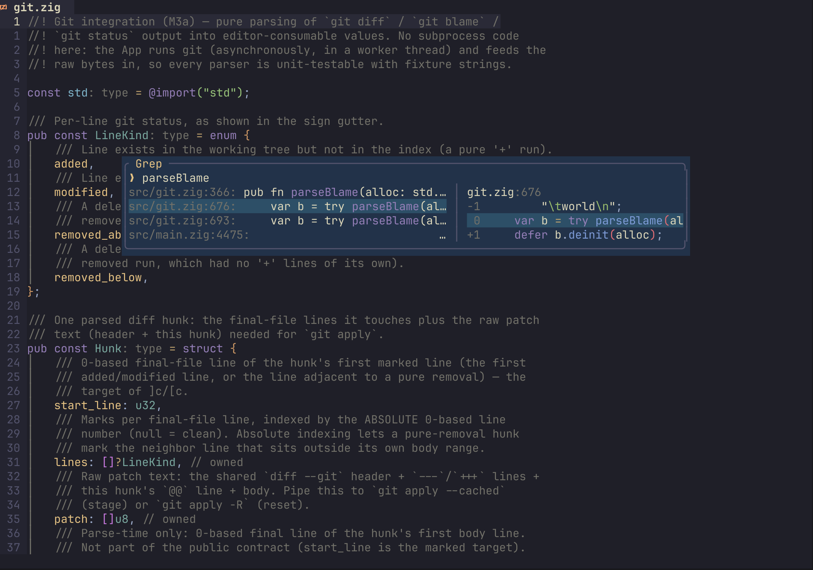
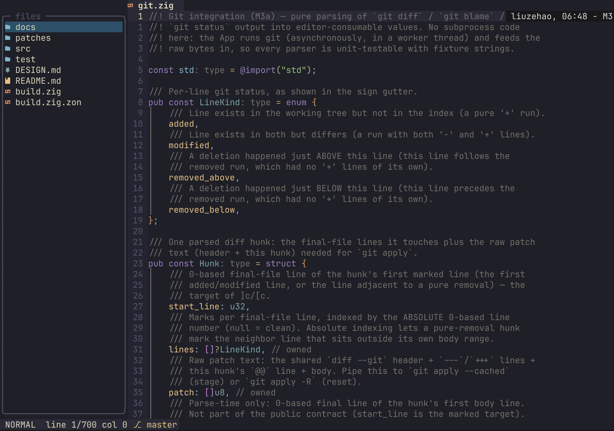
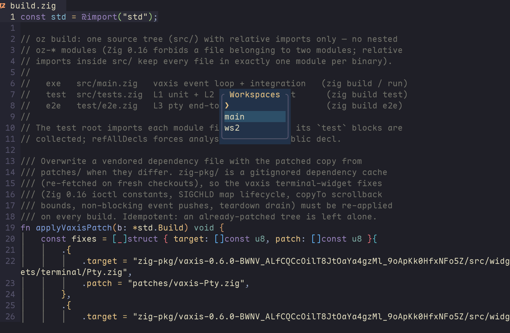
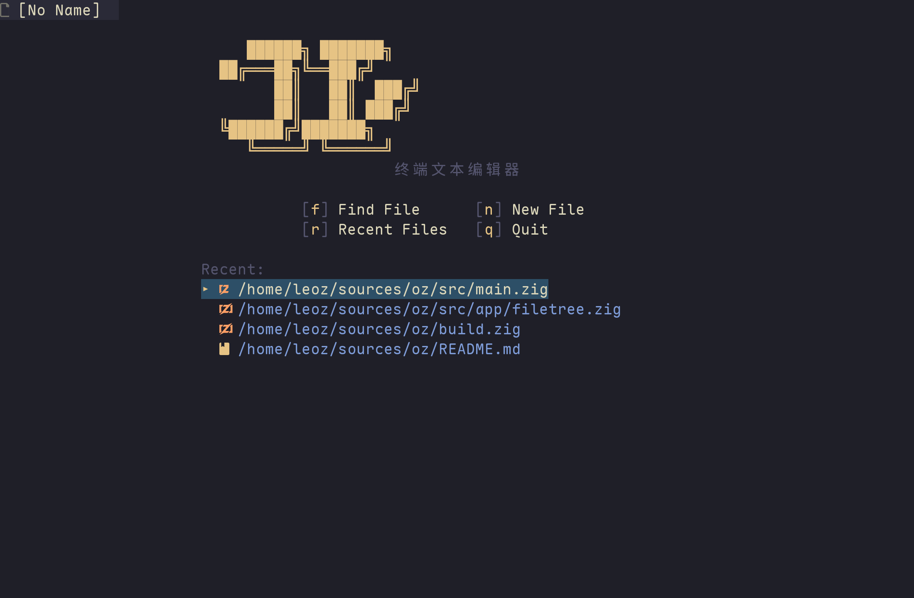
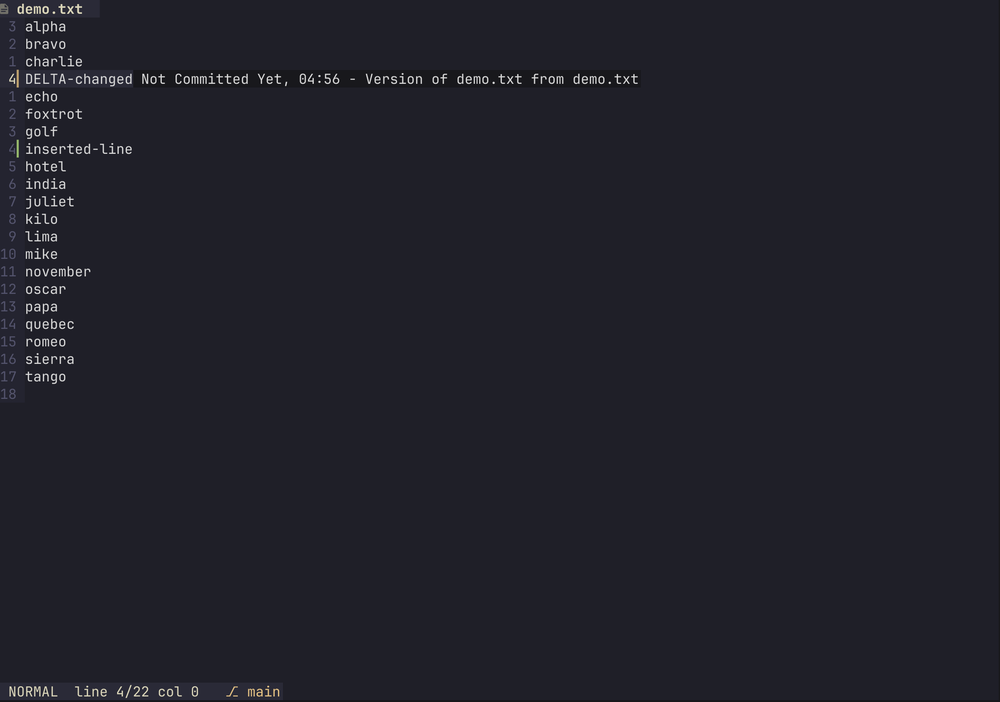
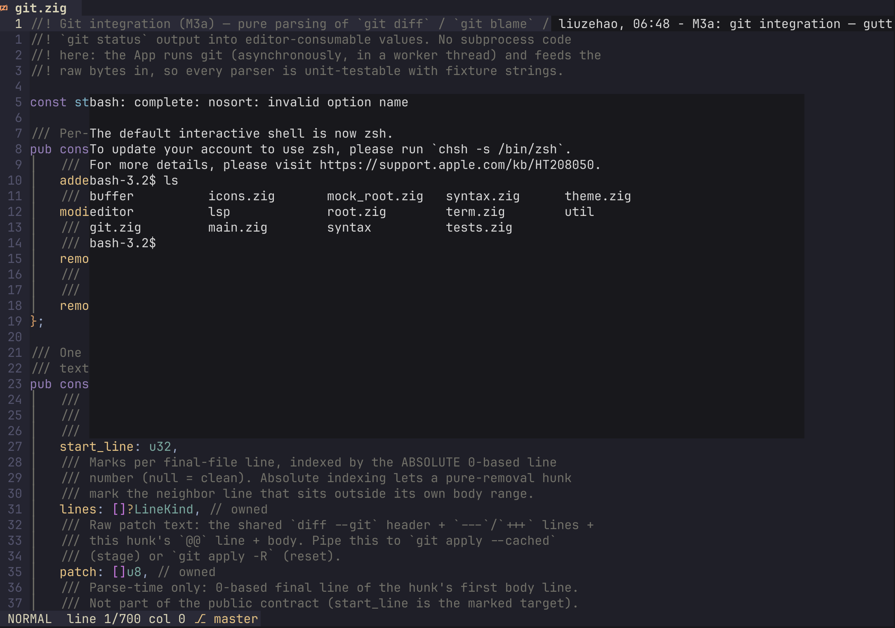

# oz

[English](README.md) | 中文

终端文本编辑器，使用 Zig 编写。

## 功能

**编辑（vim 系）**

- Normal / Insert / Visual / Visual Line / Visual Block / Command 六种模式
- 完整移动与 count：hjkl、w/e/b/ge、^/0/$、gg/G、{/}、%、f/F/t/T、Ctrl-u/d/f/b
- 文本对象、surround、注释、对齐、EasyMotion（s / `<leader>f`）、多光标（Ctrl+n）
- 撤销/重做（分组 + 分支语义）、寄存器语义（linewise/charwise yank & put）并与系统剪贴板互通（OSC52 + pbcopy/wl-copy/xclip/xsel，对齐 nvim `clipboard=unnamedplus`）
- 键盘宏：`q{reg}` 录制（再按 q 停止）、`@{reg}` 回放（支持 `3@a` 次数与 `@@` 重复），可视模式下 `@` 对选区逐行回放（`:'<,'>normal!` 语义），状态栏显示 `recording @x`
- 分屏（:sp/:vs + Ctrl-w 系列）、buffer 标签栏、相对行号、代码折叠

**语法与界面**

- tree-sitter 语法高亮（内置多种语言 grammar）、彩虹括号、indent guide + scope 高亮动画
- markdown 内联渲染：标题/粗体/斜体/链接/行内代码高亮，fence 代码块按语言上色，光标行之外隐藏标记符号（conceal），checkbox 图标，标题/代码块背景带
- 多主题（`<leader>sp` 主题选择器，实时预览；选择自动持久化，无需任何配置或环境变量）：kanagawa-wave、kanagawa-dragon、catppuccin（latte / frappe / macchiato / mocha）、tokyonight（night / storm / moon）、everforest、onedark、melange、doom-one、sonokai-shusia、flexoki-dark、flexoki-light
- 长行软换行：超过窗口宽度的行折行显示（grapheme/CJK 宽度感知）
- 大文件降级：超过 100KB 自动关闭高亮，保证流畅



**LSP**

- 异步接入（不阻塞启动），支持 zls 等常见 server（自动探测 mason 安装路径）
- hover（K）、定义/声明/引用/实现跳转（gd/gD/gr/gI）、signature help（gs）
- 诊断 gutter 标记 + `]d`/`[d` 跳转 + 诊断列表（`<leader>sd`）
- 自动补全菜单 + ghost text（`<C-n>`/触发字符）、inlay hints（`<leader>ti`）
- 重命名（`<leader>rn`）、格式化（`<leader>lf`）、文档大纲（`<leader>o`）



**导航与查找**

- 模糊查找 picker：文件（`<leader>sf`）、grep（`<leader>st`）、buffer（`<leader>sb`）、最近文件（`<leader>sr`）、快捷键（`<leader>sk`）
- **Navigator**（`<leader>e` 开关，`<leader>E` 定位当前文件）：左侧 30 列侧栏，三个 tab——`files`（原有惰性文件树，根目录跟随当前 workspace 的项目目录）、`notes`、`agents`。聚焦侧栏时 `Tab`/`Shift-Tab` 循环 tab，`1`/`2`/`3` 直接跳转；`h`/`l` 仍是文件树的折叠/父目录。每个 tab 和列表行都是 `<leader>j` 的 hint 目标。
- **Notes**（`notes` tab）：真实的 markdown buffer，全局存放于 `$OZ_NOTES_DIR`，否则 `$XDG_DATA_HOME/oz/notes`，否则 `$HOME/.local/share/oz/notes`（目录惰性创建，启动时不扫描/不创建）。`j`/`k` 选择 · Enter 用普通 buffer 打开（`:w` 保存）· `n` 创建最小的未占用 `note-N.md`（内容 `# Untitled note`，绝不覆盖已有文件）· `r` 刷新。列表显示首个 markdown 标题（没有则文件名）、正文片段和相对时间，新的在前。Notes 与项目无关，打开 note 不会改变 workspace 文件树/picker 的根目录。删除/重命名暂不提供。
- **Agents**（`agents` tab）：同一套真实线程模型的紧凑视图（按当前 workspace 分组）——`j`/`k` 选择 · Enter 在 rail/workbox 中 attach 该线程 · `n` 新建线程。它只是视图，不是第二套线程模型。
- buffer 内搜索（`/`、`?`、n/N）







**Workspace（Doom Emacs 风格）**

- swap-on-switch 工作区：`SPC TAB n` 新建 / `.` 选择切换 / `r` 重命名 / `d` 删除 / `x` 清空 session / `[` `]` 前后切换
- 每个 workspace 独立的 buffer、窗口布局与文件树；打开已在其他 workspace 打开的文件会被拒绝（防止双重编辑）
- 文件树与模糊查找按各自 workspace 的项目根目录搜索（打开文件的最近 `.git` 目录，无 git 则为文件所在目录）
- 状态栏显示当前 workspace 名；新 workspace 显示 snacks 风格 dashboard





**Git**

- gutter diff 标记、`]c`/`[c` hunk 跳转、`<leader>hs`/`<leader>hr` stage/reset、`<leader>hp` hunk 预览
- 当前行 blame 幽灵文本（光标停 1s 后显示，`<leader>tb` 开关）、`<leader>lg` 浮动窗口 lazygit
- 状态栏显示分支名



**终端**

- 内嵌终端（Linux / macOS）：`Alt+r` 浮动 / `Alt+w` 底部 / `Alt+e` 右侧，终端内 Esc 退回 Normal



**AI Workspace（M2a）**

- `<leader>a` 打开右侧 **Agent Rail + Workbox** 并聚焦输入框；在 editor 或线程列表中再按一次会关闭 rail 并把焦点还给 editor。dock 模式下 rail 不是模态的，可以一边编辑一边使用。
- 宽度行为：**≥110 列**保留 38 列的右侧 dock；**90–109** 列保留 34；**<90** 列改为右侧 overlay drawer（`min(34, width-8)`），editor 在下方保持全宽。rail 只画到状态栏上方，绝不占用 editor 的保留区域；drawer 模式按 Esc 关闭，没有假遮罩、假 diff 或假遥测。
- **线程**是会话级的，按当前 workspace 分组显示。`j`/`k` 选择，Enter attach，`n`（或 `+`）新建线程并聚焦其输入框，输入框内 Tab 回到线程列表。同一时间只允许一个流：切换到别的线程会取消正在流式的线程（状态 `cancelled`，transcript 冻结）；切回来看到冻结的 transcript。每个线程有自己的请求历史和 client，delta 不会串到其他线程。线程在 rail 关闭和 workspace 切换后仍保留，但不落盘。
- **Workbox tabs**：Chat（沿用 M1 的 transcript、流式、取消、错误、Markdown、tool cards 与输入框）、Changes（inline edit **与 staged agent edit** 审核：真实 unified 风格 diff + 显式 Approve/Reject；没有待审内容时显示 `no pending changes`）、Tools（真实工具调用/决策统计与延迟图；没有数据时显示 `no tool calls yet`）、Terminal（`agent terminal arrives in M3`；编辑器自己的终端仍是 `Alt+r`）。空状态是真实的，不伪造 diff、计数或图表。
- **Inline assistant（`<leader>i`）**：在 visual/visual-line 中选行后按 `<leader>i`，在紧凑的 `inline edit` 浮窗里输入指令并 Enter。请求使用**独立**的 OpenAI 兼容 client 流式返回（绝不追加到 chat thread）；完成后自动打开 rail 并切到 **Changes**，badge 变 `changes 1`，diff 展示被删除的选区行和流式 replacement。未经批准不会写入：
  - Changes：`a`/Enter 批准 · `r`/`d` 拒绝 · `j`/`k` 滚动长 diff；两个按钮都是 `<leader>j` 的 hint 目标。
  - 输入框：Enter 生成 · Esc/Ctrl+c 取消 · Ctrl+w 删除最后一个词；支持 UTF-8 输入和 bracketed paste，选区在输入期间保持可见。
  - 批准时把 replacement 作为**一个 undo group** 应用（`u` 一次恢复原文）、buffer 标脏、焦点回 editor。拒绝丢弃 pending diff，buffer 逐字节不变。生成后如果 buffer 又被编辑，approve 会报 `stale selection` 并保留 pending diff，直到显式 Reject。
  - 同一时刻只允许一个 pending（或一个流式 inline 请求）；再次 `<leader>i` 会提示先 Reject 现有 pending。没有 tools、没有自动写文件、没有静默编辑。
- **Agent tools（M3a 只读 + M3b1 staged edits）**：chat 请求会带上 `read_file`、`list_directory`、`grep`、`edit_file`、`apply_patch`（`tools` + `tool_choice:"auto"`）。响应以 tool calls 结束时，每个调用在 transcript 里生成一张紧凑卡片，安全的只读调用在**后台 worker** 中针对该 thread 的 workspace root 执行——读文件/grep 永不阻塞 UI。卡片显示名称、参数摘要、真实状态（`running`/`ok`/`error`）、耗时和有上限的结果摘要；失败或被阻止的调用绝不伪装成功。结果以 `role:"tool"` 消息回填并自动发起一次后续请求（每轮最多 **4 个 tool round / 8 个实际执行调用**；触顶后最后一个请求不再带 tools，以便仍能拿到文本回答）。executor 只执行只读工具；`edit_file` 走下面的 staged-approval 路径，`apply_patch`/`terminal`/未知工具显示 `unsupported` 且绝不执行。Ctrl+c 或切线程会取消流**并**停止后续 loop/tool 执行；过期结果按 thread 丢弃。Chat 卡片是 `<leader>j` 目标：激活标签展开/收起真实结果。**Tools** tab 按线程聚合 calls/ok/error/approval/denied/unsupported、avg/max 延迟，并把最近样本画成 braille 折线图（窄屏 sparkline），例如 `read_file · calls 1 · avg 3ms · max 3ms`；图表在 metrics 或布局变化前使用缓存。Metrics 只记录真实调用——没有 mock/基线数据。
- **Staged agent edits（M3b1）**：`edit_file` tool call **绝不写盘**。oz 只读目标（已打开 buffer 的当前文本，否则读文件，上限 256 KiB），校验 `old_string`（默认必须恰好一次；`replace_all` 时全部替换），把有界 diff stage 到 **Changes**，badge `changes 1`；Chat 卡片变为 `approval required`，`role:"tool"` 结果明确写 “staged; not applied”。Approve（`a`/Enter 或 `<leader>j` hint）会打开/激活目标 buffer，重新校验完整文本与 buffer revision，把替换作为**一个 undo group** 应用（dirty；`u` 一次恢复；`:w` 仍是单独的用户写盘动作），卡片变为 `approved` 并显示真实行数。Reject 丢弃（`rejected`，metrics 记 `denied`），不碰 buffer/history/dirty。buffer/文件已变或缺失时拒绝为 `stale edit`，diff 仍可审阅。同一时刻只有一个 review（agent 或 inline）；第二笔 `edit_file` 返回 `resolve the pending edit first`。pending 按 thread 隔离：切线程隐藏 badge/review 但保留，必须回到该 thread 才能 apply。`apply_patch`/`terminal`/未知工具仍不执行（`unsupported`）。
- 按键：
  - 输入框：Enter 发送 · Ctrl+c 取消（也会停止活动 tool loop） · Ctrl+n 新建线程 · Tab → 线程列表 · Ctrl+j/k 单行滚动 · PageUp/PageDown 翻页 · Esc → editor（drawer 则关闭）
  - 线程列表 / workbox：`j`/`k` 选择 · Enter attach · `n`/`+` 新建线程 · `c`/`d`/`t`/`r` 切换 Chat/Changes/Tools/Terminal · Tab/Shift+Tab 循环 tab · `q`/Esc → editor。Changes 有 pending inline **或 agent** edit 时，`a`/Enter 批准、`r`/`d` 拒绝、`j`/`k` 滚动 diff；没有可见 pending 时这些键仍是正常的 tab 切换。
  - `<Ctrl-w> a` 从 editor 回到 rail 的线程列表（rail 关闭时也会打开）
- **键盘提示（M2.6a）**：`<leader>j` 为所有可见目标叠加 qutebrowser 风格标签（字符集 `asdfghjkl`，定长 1–3 个字符）——文件树行、buffer tab、agent 线程、navigator tab、note 行、Workbox tab、`+` 新建线程按钮、输入框行和 Changes 的 Approve/Reject 按钮。输入完整标签执行该目标原本的动作，Backspace 删除已输入字符，Esc 取消且不产生任何副作用。状态栏显示 `HINTS · N targets · Esc cancel`；没有目标时显示 `HINTS · no targets`。普通 `f` 仍是 vim find-char，hint 不会占用。可从 editor、dashboard、文件树和 AI 线程列表进入（输入框内打字时不会触发）。
- 流式 OpenAI 兼容补全（`POST {base_url}/chat/completions`，SSE）；支持 Markdown 与 fenced 代码块渲染、自动滚动
- 自动附带编辑器上下文：当前文件路径；有可视选区时附带选中文本与 1-based 行号范围；否则附带光标行 ± 少量上下文（总上限 8 KB）
- 通过环境变量配置（打开 rail 时读取）：

  | 变量 | 默认值 | 含义 |
  |---|---|---|
  | `OZ_AI_BASE_URL` | `http://127.0.0.1:11434/v1` | OpenAI 兼容 base URL（Ollama / LM Studio / DeepSeek / 网关） |
  | `OZ_AI_MODEL` | `qwen2.5-coder:7b` | 模型名 |
  | `OZ_AI_API_KEY` | 未设置 | 可选 `Authorization: Bearer …`，不会记录或持久化 |
  | `OZ_AI_SYSTEM` | 内置 | 可选 system prompt 覆盖 |

  示例：`OZ_AI_BASE_URL=https://api.deepseek.com/v1 OZ_AI_MODEL=deepseek-chat OZ_AI_API_KEY=sk-… oz`。

Notes 使用同样的环境变量风格：`OZ_NOTES_DIR=/path/to/notes oz` 可重定向全局 note 目录；不设置时使用 `$XDG_DATA_HOME/oz/notes` 或 `$HOME/.local/share/oz/notes`。

## 构建与运行

需要 Zig 0.17.0：

```sh
./.scripts/bootstrap-deps.sh                # 首次拉取 tree-sitter（下载 ~50MB，解压 ~1GB）
zig build                                    # 开发构建
zig build -Doptimize=ReleaseFast -Dstrip     # 发布构建（日常用这个）
zig build test                               # 单元测试
zig build e2e                                # pty 端到端测试（目前仅 Linux）
```

运行：`oz [file[:line]]`

## 性能

基准方法：pty 驱动 + 屏幕重建，同机（Apple Silicon, macOS）同文件，取 3 次中位数。

| 场景 | oz | nvim --clean |
|---|---|---|
| 启动（小文件） | 66 ms | 115 ms |
| 启动（5 MB / 10 万行） | 65 ms | 118 ms |
| 启动（.zig，zls 已安装） | 52 ms | 117 ms |
| G 跳到文件尾（10 万行） | 54 ms | 65 ms |
| 100× Ctrl-F 翻页 | 54 ms | 100 ms |
| 500× j 光标移动 | 53 ms | 100 ms |
| 输入 100 字符 | 64 ms | 66 ms |
| 10 万行文件尾部输入 30 字符 | 71 ms | 56 ms |
| 全文搜索（10 万行） | 58 ms | 66 ms |
| 带 LSP 连续输入 60 字符 | 60 ms | 56 ms |

全部场景与 nvim 持平或更快。关键设计：mmap 惰性加载文件、PieceTable 增量行索引、tree-sitter 增量解析、LSP 异步握手 + 写入线程 + 增量同步、原子化保存（temp+rename）。

## 下载

预编译二进制见 [GitHub Releases](https://github.com/niT-Tin/oz/releases)（Linux x86_64/arm64、macOS x86_64/arm64，解压即用，无需安装 Zig）。源码构建见上文「构建与运行」。

## License

[MIT](LICENSE) © niT-Tin

## 维护预期

个人项目，业余时间维护，请合理预期：

- 功能按我自己的使用需求驱动；发现 bug 欢迎提 issue（附复现步骤最佳）；
- PR 会看、会合，但节奏取决于我的时间；
- 0.x 阶段键位 / 接口可能有不兼容调整；
- 顺手 star 一下就是最好的鼓励。
