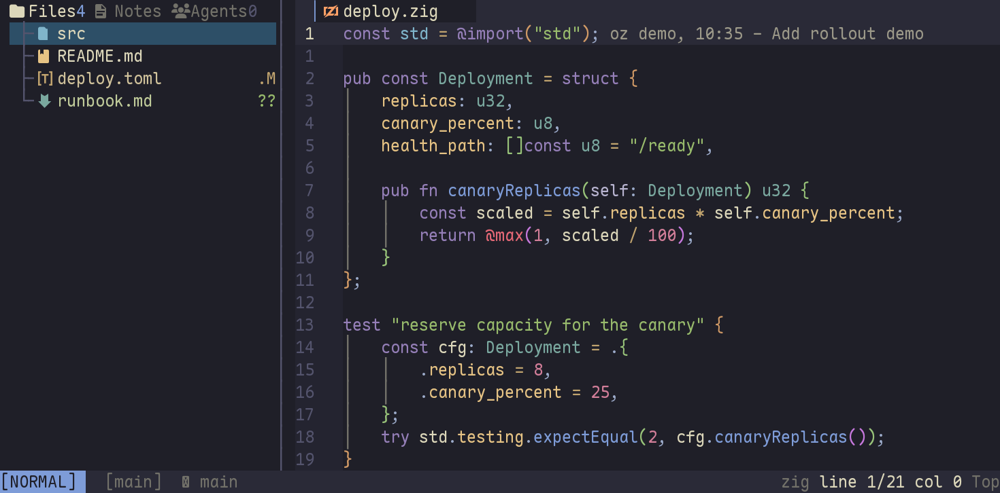

# oz

用 Zig 编写的 Vim 风格终端编辑器。可以分屏改代码，用 LSP 查定义，也可以通过 ACP 把 Codex、Kimi Code 或 DeepSeek Harness 接到代码旁边。

[下载](https://github.com/niT-Tin/oz/releases/latest) · [官网](https://nit-tin.github.io/oz/?lang=zh) · [English](README.md)



## 打开第一个文件

下载适合你的 Linux 或 macOS 压缩包（x86_64 或 arm64），解压后运行：

```sh
./oz path/to/file
```

按 `i` 开始编辑，`Esc` 回到普通模式，输入 `:wq` 保存退出。`Space e` 打开文件树，`F1` 查看全部快捷键。

文件树右侧的两列 Git 状态分别对应暂存区和工作区。`M.` 表示修改已暂存，`.M` 表示磁盘文件有未暂存的修改，`MM` 表示两者都有。`A`、`D`、`R` 分别表示新增、删除、重命名，`UU` 表示双方修改导致的冲突，`??` 表示未跟踪文件。目录旁的 `*` 表示其中有变更。

用 `Space g v` 或 `:GitReview` 打开 Git 审查。按 `Tab` 切换工作区变更和提交历史，`Enter` 查看差异，`o` 跳到源码对应行。

## Markdown 图表和图片

在 Ghostty 和 Kitty 里，oz 可以显示 Markdown 本地图片和 Mermaid 图表。运行 `npm install -g @mermaid-js/mermaid-cli` 安装渲染器，再用 `oz notes.md` 打开文件。oz 会从 PATH 自动查找 `mmdc`，在 Normal 模式下预览完整的 `mermaid` 代码块。渲染不可用时，源码仍可阅读和编辑。 [Mermaid CLI](https://github.com/mermaid-js/mermaid-cli)

[接入 coding agent](https://nit-tin.github.io/oz/?lang=zh#agents) · [从源码构建](https://nit-tin.github.io/oz/?lang=zh#download) · [更新日志](CHANGELOG.md) · [MIT 许可证](LICENSE)
